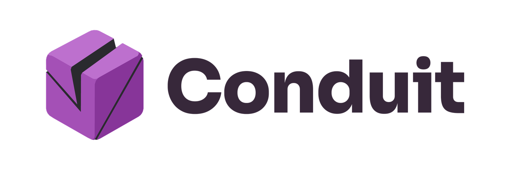

<p align="center">
  <picture>
    <source media="(prefers-color-scheme: dark)"
            srcset="docs/brand/lockup/banner/lockup-horizontal-dark-banner.png">
    
  </picture>
</p>

# Conduit

A free, open-source browser extension for the data your own browser already holds.
Export your cookies in the format a tool wants, or set up a rule that hands exactly
the values you choose to a local application you trust. Everything stays on your
machine: no server, no account, no telemetry.

> **Status:** early development (milestone 6). Cookie export, rules for cookies, headers and page storage with approval, a
> kill switch, a capture log and delivery to local apps work in a development build; there is no release yet. Follow the [roadmap](docs/ROADMAP.md).

## What it will do

- **Export cookies** as Netscape `cookies.txt`, JSON or a `Cookie:` header, per site and per cookie.
- **Capture named headers and page storage keys** the browser sends, receives or holds, with the same rules and approval as cookies, and keep only the part of a value you need (a pattern or a JSON field).
- **Bridge to local apps** through a small, documented HTTP contract any program can implement in a few lines: see [INTEGRATION-CONTRACT.md](docs/INTEGRATION-CONTRACT.md). The app says what it would like and why; you approve what you choose.
- **Stay readable:** every rule is one sentence (what, from where, to whom), previews are redacted until you reveal them, and a delivery log shows what was sent.

## Try it with the example app

`examples/reference_sink.py` is a complete app in about 100 lines of standard-library Python.

```bash
python examples/reference_sink.py --site example.com --names sid
```

In Conduit's rules page, under **Local apps**, choose **Look on this computer**, read what the app
asks for and why, and approve it. When that cookie changes, the app receives it, and Conduit's
delivery log shows the result.

## Install

Conduit is not in the Chrome, Edge or Firefox stores yet. You install it from a zip file, which is
a few clicks. There is nothing to sign in to and nothing is sent anywhere.

**Chrome, Edge, Brave and other Chrome-based browsers**

1. Download `conduit-<version>.zip` from the [latest release](https://github.com/BlackCanyonSoftware/conduit_extension_BCS/releases/latest). The `.sha256` file beside it lets you check the download: the SHA-256 of the zip should match it.
2. Unzip it into a folder you will keep, for example `Documents\Conduit`. The browser reads the extension from that folder every time it starts, so do not delete or move it. The folder should contain a file named `manifest.json`.
3. In the browser's address bar, type `chrome://extensions` (Edge: `edge://extensions`, Brave: `brave://extensions`) and press Enter.
4. Switch **Developer mode** on. In Chrome it is a toggle at the top right of the page; in Edge it is in the left-hand panel near the bottom.
5. Click **Load unpacked**, pick the folder from step 2 (the one containing `manifest.json`), and confirm. A card called **Conduit** appears.
6. Click the puzzle-piece icon in the browser's toolbar, then the pin beside **Conduit**, so its purple cube icon stays in view.

A fresh install does nothing until you create and approve a rule, and it can read no website until you
allow it. (The only address it holds from the start is `127.0.0.1`, this computer, where local apps live.) To update, download the new zip, unzip it over the old folder, and click the circular
arrow on Conduit's card on the extensions page.

**Firefox (140 or newer)**

Firefox only keeps add-ons that Mozilla has signed, and Conduit's is not signed yet, so Firefox
loads it for one session and removes it when it closes.

1. Download `conduit-<version>-firefox.zip` from the same release page (you do not need to unzip it).
2. In Firefox's address bar type `about:debugging#/runtime/this-firefox` and press Enter.
3. Under **Temporary Extensions** click **Load Temporary Add-on...** and pick the zip.

**Building it yourself:** `npm ci`, then `npm run build` makes the folder `dist` to load as in step 5
above (or `npm run build:firefox` makes `dist-firefox`, and you pick the `manifest.json` inside it).
`node scripts/package-release.mjs` makes the release zip, and adding `--target firefox` makes the Firefox one.

The Firefox zip and the `dist-firefox` folder are for Firefox only; Chrome-based browsers reject them with the error `'background.scripts' requires manifest version of 2 or lower`.

New to Conduit? [docs/MANUAL-CHECKS.md](docs/MANUAL-CHECKS.md) walks through every feature with the exact clicks.

## Develop

Requires Node 22 or newer (`.nvmrc`).

```bash
npm ci
npm run check
```

| Script                        | What it does                                                              |
| ----------------------------- | ------------------------------------------------------------------------- |
| `npm run build`               | Builds the unpacked extension into `dist/`                                |
| `npm run dev`                 | Rebuilds `dist/` whenever `src/` changes                                  |
| `npm test`                    | Unit tests (Vitest)                                                       |
| `npm run test:e2e`            | Builds, then runs the Playwright tests in headless Chromium               |
| `npm run test:e2e:firefox`    | Builds the Firefox version, then runs its background tests in Firefox     |
| `npm run test:e2e:firefox-ui` | Drives the popup and rules page in the Firefox installed on this computer |
| `npm run lint`                | ESLint (strict, type-aware)                                               |
| `npm run typecheck`           | TypeScript `--noEmit`                                                     |
| `npm run format`              | Prettier, write                                                           |
| `npm run format:check`        | Prettier, check                                                           |
| `npm run check`               | Format check, lint, type check, tests and build                           |

The end-to-end tests need Playwright's browsers once: `npx playwright install chromium firefox`. `npm run test:e2e:firefox-ui` also needs Firefox installed. To run the Chrome tests in Edge instead: `$env:CONDUIT_CHANNEL='msedge'; npm run test:e2e` (PowerShell).

`npm ci` also points git at `.githooks/`, whose pre-commit hook checks formatting and lint on staged files.

## Project layout

```
src/        extension source (manifest.json, core logic, UI)
scripts/    build and tooling scripts
tests/      unit tests (unit/) and Playwright end-to-end tests (e2e/)
docs/       PRD, roadmap, architecture, design, ADRs, handoff
```

## Documentation

[PRD](docs/PRD.md) · [Roadmap](docs/ROADMAP.md) · [Architecture](docs/ARCHITECTURE.md) · [Design](docs/DESIGN.md) · [Integration contract](docs/INTEGRATION-CONTRACT.md) · [Contributing](CONTRIBUTING.md)

## Licence

MIT, with no warranty. See [LICENSE](LICENSE).

`src/core/cookies/public-suffix-data.ts` is data from the [Public Suffix List](https://publicsuffix.org), which is under the [Mozilla Public License 2.0](https://mozilla.org/MPL/2.0/); that file keeps its notice. The brand assets in `src/theme/` and `docs/brand/` come from the Black Canyon Software brand kit, and the fonts in `src/theme/font/` carry their own licence files.
