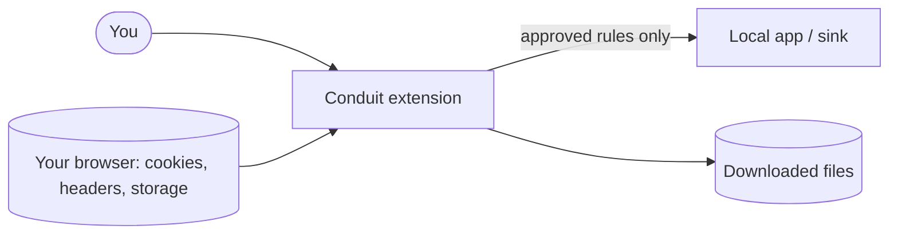
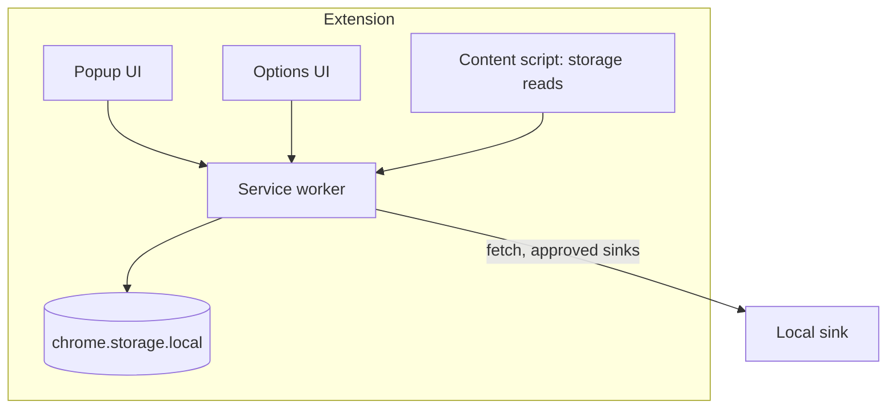
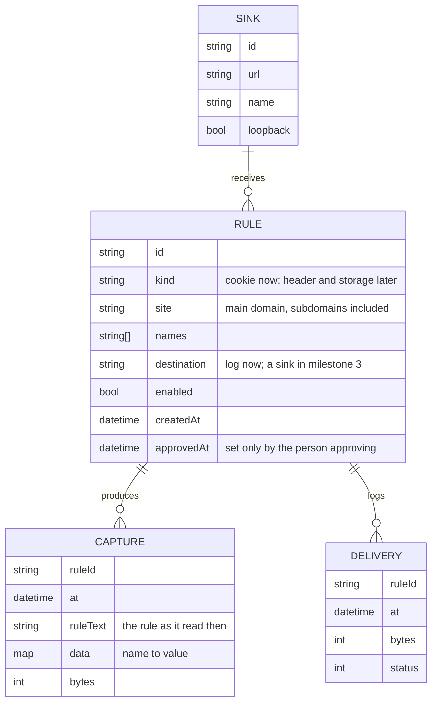
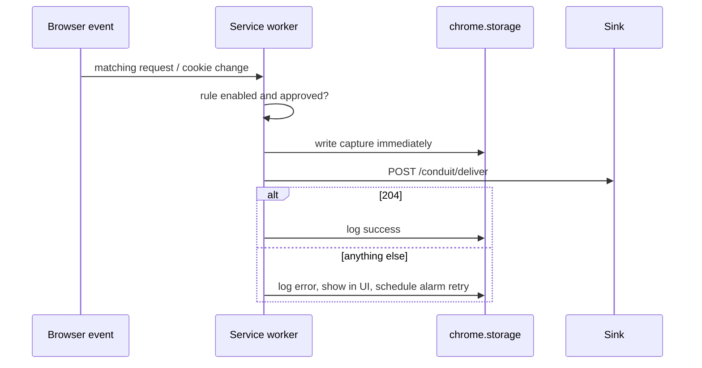

# Architecture

## Stack and rationale

| Choice                            | Why                                                       | Alternative considered                                |
| --------------------------------- | --------------------------------------------------------- | ----------------------------------------------------- |
| TypeScript (`strict`)             | Types for browser-API payloads and the sink contract      | Plain JavaScript (fewer tools, weaker guarantees)     |
| esbuild                           | One small dependency, fast, easy to read the output       | Vite/WXT (more features than a small extension needs) |
| Vanilla DOM for popup and options | Few moving parts to audit                                 | Preact/Svelte (more dependencies)                     |
| Vitest                            | Fast unit tests that share the esbuild toolchain          | Jest                                                  |
| Playwright                        | Loads the real extension in Chromium for end-to-end tests | Puppeteer                                             |
| Brand template CSS                | Shared Black Canyon look and tested contrast              | Hand-written styles                                   |

See [ADR 0001](adr/0001-stack.md).

## Context



## Containers



## Folder structure

```
src/
  core/          pure logic, no browser APIs (unit-tested)
    cookies/     formats: netscape, json, header string; selection
    rules/       rule model and status, one-sentence summary, validation, import/export
    capture.ts   matching, duplicate-skipping captures, the capped log
    sinks/       contract types, handshake parsing, loopback check (milestone 3)
    redact.ts    first/last four preview
    extract.ts   regex / JSON-path extractors (milestone 5)
  platform/      thin wrappers over chrome.* / browser.* (the only code that touches them)
  background/    service worker: cookie-change capture, capture now, badge; alarms and delivery queue in milestone 3
  popup/         popup UI: cookies for the active site, rules bar and kill switch
  options/       rules page: rules, approval, log; sinks in milestone 3
  ui/            helpers shared by the pages: DOM builder, download, info toggle, theme button, shared.css
  content/       storage-reading content script (milestone 5)
  theme/         brand template CSS bundled from the brand kit (generated)
examples/        reference sink (Python, standard library only)
tests/           unit, e2e
docs/            this folder
```

Rule: `core/` imports nothing from `platform/`. Browser APIs sit behind small
interfaces so tests use fakes.

## Data model



## Delivery flow



## Cross-cutting

- **Service worker lifetime:** MV3 workers stop when idle, so every capture is persisted before anything else; retries use `chrome.alarms`.
- **Permissions:** host access requested per site at approval time (`optional_host_permissions`).
- **Errors:** specific error types; the UI states what happened and what to do; the log keeps details.
- **Logging:** the delivery log records time, rule, byte count and destination, never the values.
- **Security model:** nothing is captured without an approved rule; imported rules arrive disabled; non-loopback destinations require a typed confirmation; previews are redacted.
- **Configuration:** none remote. Everything ships in the package.

The wire format between Conduit and sinks is in
[INTEGRATION-CONTRACT.md](INTEGRATION-CONTRACT.md).
